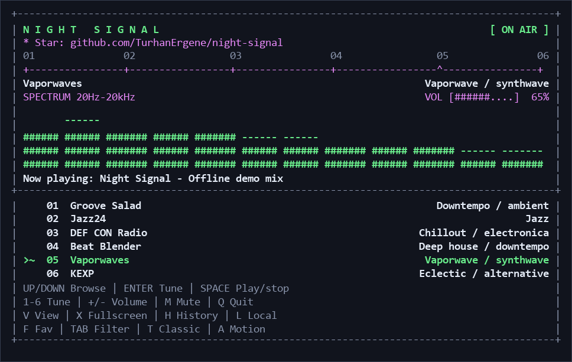
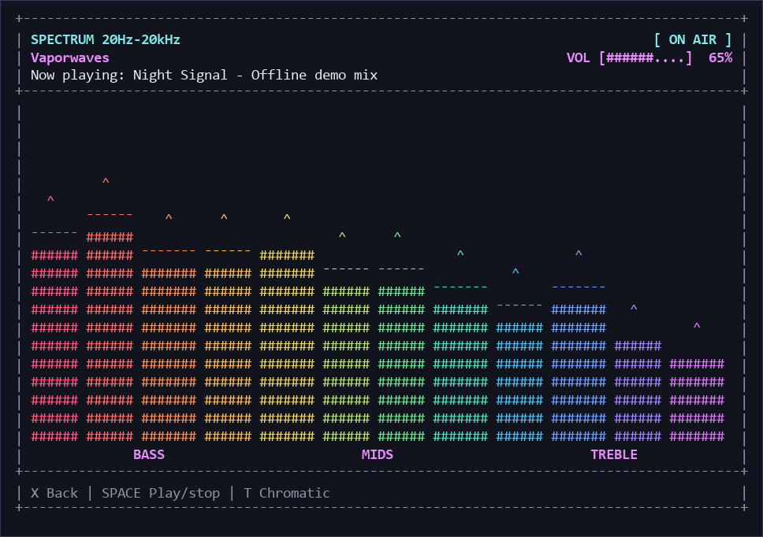

# Night Signal

An internet radio and local music player for your terminal with a live waveform and 12-band spectrum.



Enjoy Night Signal? [Star the project on GitHub](https://github.com/TurhanErgene/night-signal).

## Setup

Open a terminal in the `night-signal` folder after cloning the repo or extracting the ZIP. Night Signal needs Python 3.10 or newer and `ffmpeg` on your PATH. Windows uses its built-in audio output. macOS and Linux also need `ffplay`. If you just installed the dependencies, open a new terminal.

| System | Install missing dependencies | Check | Launch |
| --- | --- | --- | --- |
| Windows (PowerShell) | `winget install --id Python.Python.3.13 -e` and `winget install ffmpeg` | `.\radio.cmd --check` | `.\radio.cmd` |
| macOS (Homebrew) | `brew install python ffmpeg` | `python3 radio.py --check` | `python3 radio.py` |
| Debian / Ubuntu | `sudo apt install python3 ffmpeg` | `python3 radio.py --check` | `python3 radio.py` |

On other Linux distributions, install Python and an FFmpeg package that includes `ffplay` using your package manager. Add `--demo` to the launch command to hear a test tone and try the controls offline.

## Find stations

Press `/` to open station discovery. Use `Tab` to choose name, genre, country, or URL. Type a search and press `Enter`. In the results, use Up and Down to select a station, `P` to save it as a preset, or `Enter` to save and tune it. Search uses the [Radio Browser directory](https://www.radio-browser.info/).

To add a station directly, select URL mode and paste its stream URL. Use `Name | URL` to give it a custom name. Press `Enter` to save it, then find it in the preset list.

## Local music

Put your music in the `music` folder beside `radio.py`, then press `L`. Night Signal queues supported files from the folder and its subfolders in path order. Press `N` or `P` to skip tracks, or `L` again to return to radio.

Press `O` to open the music folder in your file manager. If the folder is empty, Night Signal shows its full path. Press `C` to copy it and paste it into File Explorer's address bar, or press `L` to scan again after adding files.

You can also launch with one or more files or folders as arguments.

```powershell
.\radio.cmd --play "C:\Music\Album" "C:\Music\Loose Track.flac"
```

```bash
python3 radio.py --play "$HOME/Music/Album" "$HOME/Music/Loose Track.flac"
```

Folder playback supports MP3, FLAC, WAV, M4A, AAC, AIFF, ALAC, Ogg, Opus, and WMA. When a local file has artist and title tags, Night Signal displays them. Otherwise it uses the filename.

## Controls

| Key | Action |
| --- | --- |
| Up / Down or `J` / `K` | Browse presets or move through the current list |
| `Enter` | Tune or retry the selected station, or play the current file |
| `1`–`9` | Tune the corresponding preset if configured |
| `Space` | Stop or start playback |
| Left / Right or `-` / `+` | Decrease or increase volume |
| `M` | Mute or unmute |
| `V` | Switch between the waveform and spectrum |
| `X` | Open or close the fullscreen spectrum |
| `W` | Open or close the scrolling waterfall spectrum |
| `T` | Cycle through Classic, Amber, Chromatic, and Mono |
| `A` | Toggle horizontal motion for the title and GitHub link |
| `H` | Open or close track history |
| `C` in history | Copy the selected title |
| `/` | Find stations or add a stream URL |
| `S` | Save the current track title or the highlighted history entry |
| `B` | Open saved songs. Press `C` to copy or `S` to remove an entry |
| `Z` | Cycle the sleep timer through 15, 30, 60 minutes, and off |
| `L` | Switch between local music and radio |
| `O` | Open the local music folder |
| `N` / `P` | Next or previous local track |
| `F` | Add or remove the highlighted preset from favorites |
| `Tab` | Switch between all presets and favorites. Use `F` in all presets to add a favorite |
| `Q` | Quit |

In fullscreen mode, the spectrum runs from 20 Hz on the left to 20 kHz on the right. The `^` markers briefly hold peaks after a loud hit. Set `NO_COLOR=1` in your environment to override the color theme.



The waterfall shows recent spectrum snapshots. New rows appear at the bottom. A sleep timer shows its remaining time in the top border and stops playback when it expires.

History keeps up to 100 entries from local files and streams that provide ICY track titles. Copying uses the system clipboard. On Linux, install `wl-clipboard` for Wayland or `xclip` for X11 if copying is unavailable.

Saved songs store the title and source for later lookup. Saved songs, custom presets, favorites, the last tuned station, volume, mute, appearance preferences, and track history are saved in `settings.json` beside the app. Night Signal resumes the last radio preset on a normal launch. If a stream drops, it retries up to five times. Press `Space` to cancel a pending retry.

Add `--list` to print the presets or `--version` to check your installed version. To edit the built-in presets, update `stations.json` with up to nine names, genres, and direct HTTP(S) audio stream URLs.

Preset streams are provided by [SomaFM](https://somafm.com/listen/), [Jazz24](https://www.jazz24.org/streaming-links/), and [KEXP](https://www.kexp.org/mobile/kexp-livestreams/).
